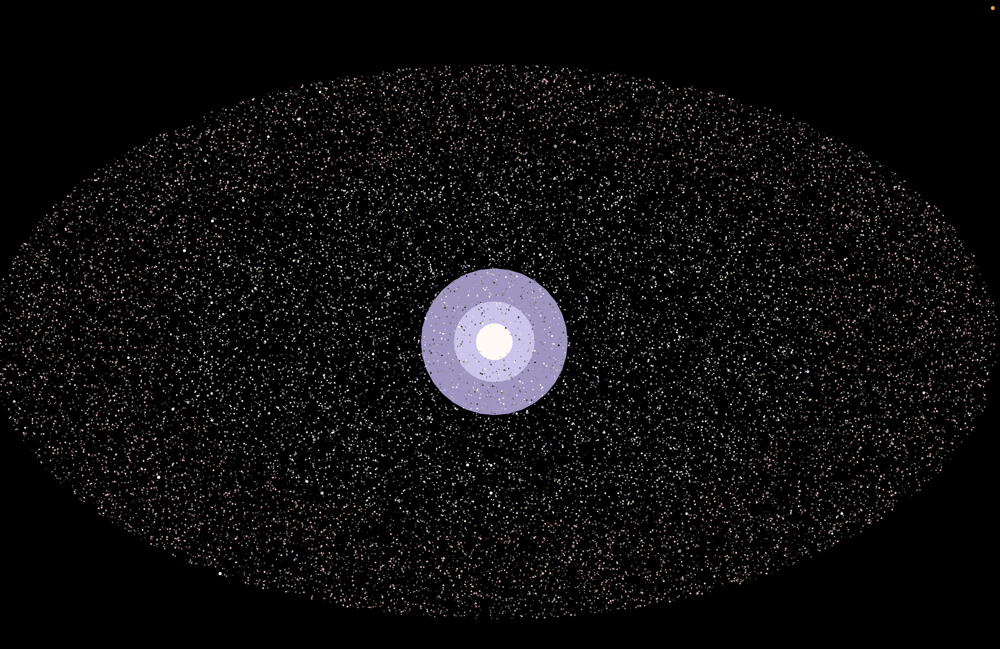
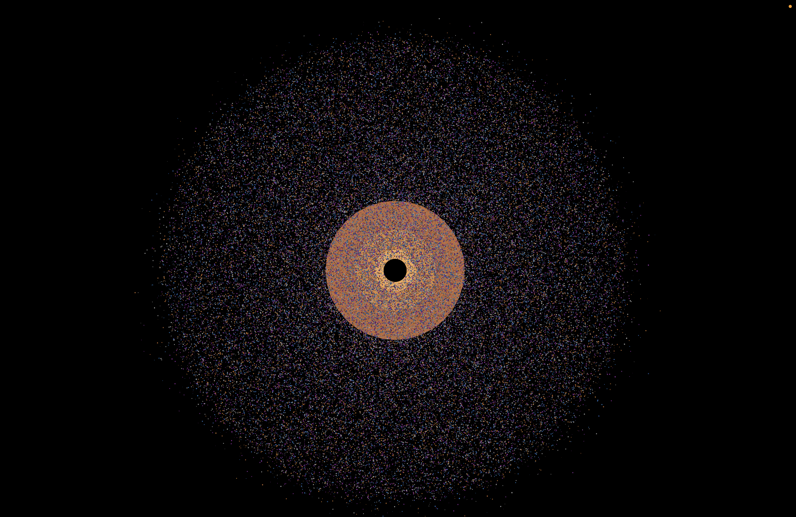
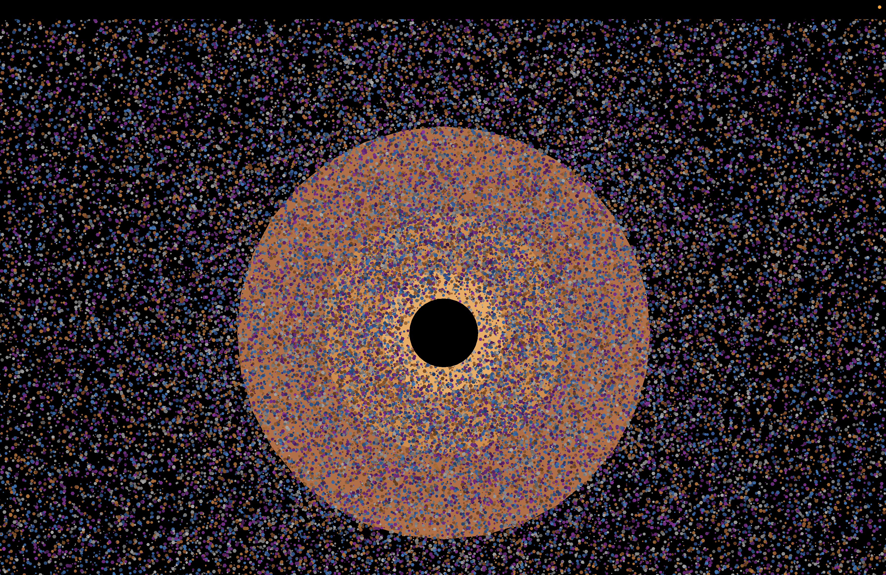

# NV2D Graphic Engine

NV2D is a lightweight, modern 2D graphic engine built in Java and powered by LWJGL (Lightweight Java Game Library). It offers a straightforward API for rendering, scene management, post-processing shaders, input handling, and cross-platform native packaging.

---

## Benchmark Preview

Here are screenshots from the built-in benchmark scene stress-testing rendering and physics:

<p align="center">
  
  
  
</p>

---

## Getting Started

### Prerequisites

- **Java JDK 21+** (or modern Java support with Preview features enabled if applicable)
- **Gradle** (or use the included `./gradlew` wrapper)

### Quick Test & Benchmark

To verify your environment and test engine performance with a quick benchmark:

```bash
# On macOS / Linux
./gradlew nvBenchmark

# On Windows
gradlew.bat nvBenchmark
```

This task runs `BenchmarkMain` (located in `engine/src/main/java/nv/benchmark/BenchmarkMain.java`) with all required native libraries and JVM arguments preconfigured.

---

## Running the Application

To run the application directly in development mode:

```bash
# Run application
./gradlew run
```

> **Note for macOS users:** LWJGL requires the `-XstartOnFirstThread` argument on macOS, which is automatically handled by the Gradle tasks.

---

## Component Architecture (`NvComp`)

Every visible or interactive object in NV2D is represented by `NvComp` (or its RGB subclass `NvRgbComp`).

### Core Lifecycle Methods:
- **`update(float dt)`**: Called on each frame update. Use this for physics calculations, animations, and state updates.
- **`drawIntern(NvGraphic g)`**: Called when the engine renders the component. Coordinates passed here are relative to the component origin `(0, 0)`.

### Optional Capability Interfaces:
You only implement the interfaces you need. NV2D automatically discovers them when a component is added via `addChild()` and registers them with the relevant engine subsystems:

| Interface | Engine Subsystem | Purpose & Hook |
| :--- | :--- | :--- |
| **`Collidable`** | `CollisionManager` | Enables AABB collision detection and resolution. Implement `whenCollide(NvComp other)`. |
| **`Hoverable`** | `HoverSystem` | Tracks mouse hover state. Engine updates `isHovered`, `hoveredX`, and `hoveredY`. |
| **`Clickable`** | `ClickSystem` | Handles mouse clicks and releases within component bounds: `onClick(int x, int y)` & `onClickRelease(int x, int y)`. |
| **`KeyboardListener`** | `KeyboardSystem` | Listens for keyboard events (press, release, hold) using GLFW keys. |

---

## The Graphics API (`NvGraphic`)

Inside `drawIntern(NvGraphic g)`, you have direct access to NV2D's high-performance 2D rendering pipeline.

### Color and State:
- `g.setRGB(float r, float g, float b)`: Sets the current drawing color (values from `0.0f` to `1.0f`).
- `g.setRGBA(float r, float g, float b, float alpha)`: Sets color with alpha transparency.
- `g.setTransparency(float alpha)`: Changes current alpha without altering RGB.

### Immediate Primitive Drawing:
- **Rectangles**: `g.drawRect(x, y, w, h)`, `g.drawRoundRect(x, y, w, h, radius)`, `g.drawRectBorder(x, y, w, h, thickness)`.
- **Circles & Ellipses**: `g.drawOval(x, y, radius)` or with accuracy/segments: `g.drawOval(x, y, radius, accuracy)`.
- **Polygons & Lines**: `g.drawLine(x1, y1, x2, y2, thickness)`, `g.drawTri(base1, base2, y)`, `g.drawPentagon(...)`, `g.drawHexagon(...)`.
- **Text & Images**: `g.drawText("Hello NV2D", x, y)`, `g.drawImage(image, x, y, w, h)`.

### Batch Rendering (High-Volume Performance):
For particle systems or thousands of shapes per frame (300k+), wrap draw calls in a batch block to reduce GPU draw calls and achieve a 20-30% FPS boost:
```java
g.beginBatch();
for (int i = 0; i < count; i++) {
    g.batchDrawOval(x[i], y[i], radius[i], 1.0f, 0.5f, 0.2f);
}
g.endBatch();
```

---

## Component Example

The following example demonstrates a custom interactive game entity that optionally implements `Collidable`, `Clickable`, and `Hoverable`:

```java
package mygame;

import nv.core.collision.Collidable;
import nv.core.components.NvComp;
import nv.core.graphic.NvGraphic;
import nv.core.io.Clickable;
import nv.core.io.Hoverable;

public class InteractivePlayer extends NvComp implements Collidable, Clickable, Hoverable {

    private boolean isActivated = false;

    public InteractivePlayer(float x, float y, float width, float height) {
        super(x, y, width, height);
        // Optional configuration:
        // this.setZIndex(10);        // Controls collision layer
        // this.setPhaseThrough(true); // Triggers collision callbacks without physical pushback
    }

    @Override
    public void update(float dt) {
        // Hoverable provides isHovered, hoveredX, and hoveredY automatically
        if (isHovered) {
            // React to mouse hover
        }
    }

    @Override
    public void drawIntern(NvGraphic g) {
        // Draw background relative to (0, 0)
        if (isHovered) {
            g.setRGB(0.2f, 0.8f, 0.2f); // Green highlight on hover
        } else if (isActivated) {
            g.setRGB(0.9f, 0.3f, 0.3f); // Red when active
        } else {
            g.setRGB(0.2f, 0.4f, 0.8f); // Default blue
        }

        g.drawRoundRect(0, 0, getW(), getH(), 12f);

        // Draw inner accent and label
        g.setRGB(1.0f, 1.0f, 1.0f);
        g.drawRectBorder(2, 2, getW() - 4, getH() - 4, 1.5f);
        g.drawText("PLAYER", 10, 20);
    }

    // --- Clickable implementation ---
    @Override
    public void onClick(int clickX, int clickY) {
        isActivated = !isActivated;
    }

    @Override
    public void onClickRelease(int releaseX, int releaseY) {
        // Optional release logic
    }

    // --- Collidable implementation ---
    @Override
    public void whenCollide(NvComp other) {
        // Handle collision with obstacles or other entities
    }
}
```

---

## Building the Project (`nvbuild`)

NV2D includes dedicated Gradle tasks to build fat/shadow JARs bundled with the appropriate LWJGL platform natives.

### Build Tasks

- **`nvBuild`**: Builds JAR artifacts for all target platforms (`macos-arm64`, `windows`, `linux`) plus a universal bundle:
  ```bash
  ./gradlew nvBuild
  ```
- **Platform-specific Builds**:
  ```bash
  ./gradlew nvBuildMac       # macOS (Apple Silicon / ARM64)
  ./gradlew nvBuildWindows   # Windows (x64)
  ./gradlew nvBuildLinux     # Linux (x64)
  ./gradlew nvBuildAll       # Universal bundle with natives for all supported platforms
  ```

All built JARs are output to:
```
build/libs/
```

---

## Packaging Native Distributions (`nvpackage`)

To produce ready-to-distribute native executables and packages, use the `nvPackage` suite:

```bash
# Package for the current platform and generate Windows executable bundle
./gradlew nvPackage
```

### Packaging Details:
- **macOS**: Uses `jpackage` to produce a standalone `.app` bundle (`build/dist/<AppName>.app`) using icons generated from `src/main/resources/gameicon/gameIcon.png`.
- **Windows**: Produces a Windows `.exe` using Launch4j and bundles it into `build/dist/<AppName>.zip` containing the executable, required JARs, and runtime files.
- **Linux**: On Linux environments, builds a native `.deb` package via `jpackage`.
- **Fallback**: If building for macOS from non-macOS platforms, `nvPackageMacFallback` generates a runnable `run-mac.sh` script alongside the macOS JAR.

Generated distribution files are placed in:
```
build/dist/
```

---

## Basic Main Example

Here is a simple example showing how to initialize the engine and add your components in `src/main/java/Main.java`:

```java
import nv.core.ContextBuilder;
import nv.core.NvContext;

void main() {
    // Initialize the engine context
    NvContext context = new ContextBuilder("START", true)
            .setVsync(true)
            .setIdleWhenUnfocused(true)
            .build();

    // Create initial page / scene
    var page = context.newPage();
    page.setBackgroundColor(0.1f, 0.1f, 0.1f);

    // Add custom component
    page.addChild(new InteractivePlayer(100, 100, 150, 60));

    // Start loop
    context.run();
}
```

---

## Running Engine Unit Tests

To run the engine test suite:

```bash
./gradlew nvTest
```
